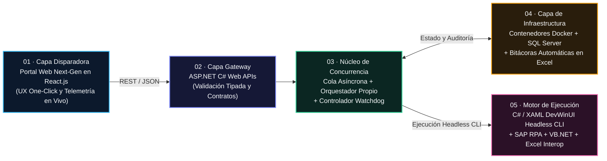

<div align="center">

<br />

[](https://curriculum-vitae-topaz-beta.vercel.app)
[](./public/Alan_Avina_CV.pdf)
[](https://www.linkedin.com/in/alan-avina)
[](mailto:alan.avinav@gmail.com)

<br />

# ALAN EMMANUEL AVIÑA VENEGAS

### **Ingeniero de Software y Automatización · Sistemas Distribuidos · Full-Stack & Design Engineering**

*`.NET / C#` · `ASP.NET Web APIs` · `React.js & Next.js` · `Docker & SQL` · `SAP RPA` · `Three.js / WebGL` · `AWS Cloud`*

<br />

[🇺🇸 English Version](./README.md) · 🌐 **Español**

<br />

> **La mayoría de los ingenieros se especializan solo en la solidez del backend o en la estética del frontend.**  
> **Yo construyo la vertical completa**—desde orquestadores distribuidos libres de colisiones y motores headless en `.NET`, hasta planos de control en `React / WebGL`—alineando a líderes de negocio y equipos técnicos para entregar **ROI medible desde el primer día**.

</div>

---

## ⚡ Resumen Ejecutivo — Qué Aporto A Su Equipo 

| **230+ hrs/año Ahorradas** | **0 Colisiones de Proceso** | **0 ms de Overhead UI** | **Liderazgo y Alineación Ejecutiva** |
| :--- | :--- | :--- | :--- |
| Soluciones críticas de **SAP RPA** en **Aumovio** que transforman flujos manuales en un clic: **19+ hrs/mes** (**+1 mes laboral completo al año**). | **Cola Asíncrona + Orquestador Propio + Watchdog de Concurrencia** sobre **Docker**, **SQL Server** y **ASP.NET C# Web APIs**. | Motor desktop dual **C# / XAML (`DevWinUI`)** con ejecución **Headless CLI** disparado remotamente desde un portal web **React.js**. | Enlace principal de ingeniería entre **Financial Controlling**, **TI** y alianzas institucionales (**Gobierno de Jalisco, SITEUR, Mi Bici**). |

---

## 🎯 Cómo Multiplico el Valor de Tu Equipo Desde el Día Uno

Ya sea que tu empresa necesite sistemas empresariales de misión crítica, productos digitales de alta calidad o un perfil capaz de traducir objetivos ejecutivos en arquitectura confiable, esto es lo que entrego:

| Si Tu Equipo Necesita... | Lo Que Aporto de Inmediato | Evidencia en Producción |
| :--- | :--- | :--- |
| **Backend Empresarial, .NET y Automatización de Procesos** | `C# / .NET`, `ASP.NET Web APIs`, `SAP RPA`, `SQL Server`, `Docker`, control de concurrencia y colas asíncronas tolerantes a fallos que convierten procesos manuales en flujos auditables de un clic. | **Aumovio:** Infraestructura on-premise de automatización distribuida con **230+ hrs/año ahorradas** y **0 colisiones COM/servidor**. |
| **Desarrollo Full-Stack y Design Engineering** | Dominio completo en `React.js`, `Next.js`, `TypeScript`, `Laravel`, `Python`, `Java Servlets` y `Three.js / GSAP`—combinando contratos API estrictos con interfaces fluidas y memorables. | **Este Web CV 3D**, **Restaurant POS** (PayPal + colas de cocina en vivo) y **MyPetHealth** (Scrum + animaciones SVG). |
| **Entrega Cloud, Telemetría y Liderazgo Técnico** | Ejecución certificada en `AWS Cloud Practitioner` y `Scrum (SFPC)`, sprints diarios, analítica conductual (`Google Analytics`), gobierno Gantt y comunicación asertiva con direcciones y jefaturas. | **Alianza Rinconcito:** Enlace técnico con **Gobierno de Jalisco**, **SITEUR**, **Mi Bici** y aliados culturales sobre nube de alta disponibilidad. |

---

## 🏭 Caso de Éxito en Producción: Motor de Automatización Distribuida en Aumovio

**Rol:** Software & Automation Engineering Intern — *Plant Financial Controlling & Enterprise Systems* (`Jul 2026 – Presente` · Guadalajara, MX)

### El Reto de Ingeniería
Los procesos de Financial Controlling dependían de operaciones manuales intensivas en **SAP** y **datasets masivos en Excel**, consumiendo horas críticas cada mes y exponiendo los servidores a colisiones cuando múltiples cargas intentaban ejecutarse en paralelo.

### La Arquitectura que Diseñé y Desplegué
Arquitecté un **ecosistema on-premise de automatización distribuida** de extremo a extremo, conectando un portal web moderno con un motor de ejecución desktop headless de alto rendimiento:



### Resultados Clave de Negocio e Ingeniería
* **230+ Horas/Año Recuperadas (`19+ hrs/mes`):** Convertí flujos financieros manuales en ejecuciones deterministas de un solo clic sobre datasets masivos garantizando integridad total de datos.
* **Concurrencia Libre de Colisiones (`0 Colisiones`):** Diseñé un **Orquestador propio**, una **cola de procesos asíncrona** y un controlador **Watchdog** para secuenciar cargas sin choques de sesiones SAP/Excel COM y recuperar procesos detenidos de forma segura.
* **Rendimiento Headless CLI (`0 ms Overhead UI`):** Desarrollé un motor desktop **C# / XAML (`DevWinUI`)** con modo **CLI headless** que omite la carga gráfica del frontend cuando se dispara desde el portal **React.js**.
* **Gobierno Empresarial:** Trabajo diario en sprints **Scrum** entre Financial Controlling y TI sobre **GitHub empresarial**, comunicación asertiva con jefaturas y liderazgo senior, y trazabilidad mediante **roadmaps Gantt** y bitácoras automáticas en Excel.

---

## 🚀 Trayectoria Profesional y Alianzas Estratégicas

### **Aumovio** — *Software & Automation Engineering Intern*
`Jul 2026 – Presente (Programa: Jul 2026 – Jul 2027)` · `Guadalajara, MX` · *Plant Financial Controlling & Enterprise Systems*
* **Stack:** `C#` · `.NET` · `ASP.NET Web APIs` · `DevWinUI (XAML)` · `SAP RPA` · `VB.NET` · `Excel Interop` · `Docker` · `SQL Server` · `React.js` · `GitHub CI` · `Scrum`
* Desarrollo de automatización SAP RPA, orquestación distribuida en contenedores y alineación ejecutiva interdepartamental (detallado arriba).

### **Guía Cultural Metropolitana “Rinconcito”** — *Technology Infrastructure Engineer & Full Stack Developer*
`Feb 2026 – Jun 2026` · `Guadalajara, MX` · *Ecosistema Cultural Estratégico Metropolitano*
* **Stack:** `Full Stack Web` · `Cloud de Alta Disponibilidad` · `Google Analytics` · `Telemetría Conductual` · `REST APIs`
* Lideré la arquitectura técnica y la comunicación asertiva como **enlace principal de ingeniería** en una alianza respaldada por **Gobierno de Jalisco, SITEUR, Mi Bici, Casa Profunda y Arte Convergente**.
* Implementé **rastreo de patrones de preferencia** y telemetría conductual conectada a **Google Analytics** y pipelines backend sobre despliegues cloud de alta disponibilidad.

---

## 🛠️ Proyectos y Sistemas Destacados

| Proyecto | Rol | Arquitectura y Stack | Impacto de Ingeniería |
| :--- | :--- | :--- | :--- |
| **Restaurant POS & Dashboard en Tiempo Real** | Arquitecto Full Stack & UI Engineer | `Laravel` · `Tailwind CSS` · `REST APIs` · `PayPal API` · `Postman` | Plataforma inspirada en microservicios que sincroniza meseros, colas de cocina en vivo y pagos seguros con **PayPal API**, junto a un dashboard BI **Glassmorphism/Neumorphism** validado al 100% con **Postman**. |
| **MyPetHealth — Sistema Clínico Veterinario** | Project Manager (Scrum) & Lead Dev | `Python Full Stack` · `Auth Seguro` · `BD Relacional` · `Neumorphism` · `SVG` · `Scrum` | Dirigí el ciclo completo de software (SDLC) bajo **Scrum**, desarrollando autenticación cifrada y expedientes médicos sobre una interfaz **Neumorphism** con animaciones vectoriales **SVG** personalizadas. |
| **ERP y Cola Automatizada “El Paraíso”** | Full Stack Systems Developer | `Java Servlets` · `MySQL` · `WhatsApp API` · `Production Queues` | ERP administrativo integrado con portal de pedidos sobre transacciones **MySQL**, con automatización vía **WhatsApp API** que inyecta pedidos confirmados directamente a la Cola de Producción de cocina en tiempo real. |
| **Suite de Inventario y BI “Abarrotes Romero”** | Software Developer | `Python` · `Tkinter` · `Matplotlib` · `ReportLab PDF` · `SQL` | Suite de escritorio CRUD para ventas e inventarios de alta frecuencia, integrando gráficas de **Matplotlib** con **ReportLab** para generar reportes ejecutivos en PDF en un clic. |

<details>
<summary><strong>🔬 Ver Bóveda de Ciencias Computacionales y Sistemas (4 Proyectos Adicionales)</strong></summary>

<br />

* **Clínica CONSUYAD (`C# · .NET Desktop · SQL`):** Plataforma de escritorio para digitalización de expedientes clínicos y operación sin papel.
* **Simulador de Autómatas y Máquina de Turing (`Python · Teoría de la Computación`):** Simulador determinista de transiciones de estado para gramáticas formales y operaciones de cinta.
* **IA Minimax & EcoBot (`C++ · Arduino · Búsqueda Adversaria`):** Motor de teoría de juegos integrado con prototipado de robótica embebida.
* **Suite Android Nativa (`Java · Android Studio`):** Aplicaciones móviles de monitoreo biométrico y utilidades construidas con SDK nativo.

</details>

---

## 🧰 Arsenal Técnico de Espectro Completo

| Dominio | Tecnologías y Capacidades |
| :--- | :--- |
| **Lenguajes** | `C#` · `Python` · `JavaScript (ES6+)` · `TypeScript` · `SQL` · `PHP` · `Java` · `Visual Basic (VB.NET)` · `HTML5` · `CSS3` · `XAML` |
| **Backend, Desktop y RPA** | `.NET` · `ASP.NET Web APIs` · `DevWinUI` · `SAP RPA` · `Colas Asíncronas y Orquestación` · `Watchdog Concurrency` · `Excel Interop` · `Laravel` · `Java Servlets` · `REST APIs` |
| **Frontend, WebGL y UI/UX** | `React.js` · `Next.js` · `Three.js / React Three Fiber` · `GSAP ScrollTrigger` · `Lenis` · `Tailwind CSS` · `Shaders GLSL` · `Liquid Glass / Glassmorphism / Neumorphism` · `SVG Custom` · `Google Analytics` |
| **Cloud, Contenedores y Datos** | `Docker` · `SQL Server` · `MySQL` · `MongoDB` · `AWS (EC2, S3)` · `Servidores On-Premise` · `Vercel` · `Git / GitHub CI` · `Postman` |
| **Gobierno y Liderazgo** | `Scrum (SFPC)` · `Roadmaps Gantt` · `Bitácoras de Auditoría` · `Liderazgo Técnico Multifuncional` · `Comunicación Ejecutiva Asertiva` · `Customer Obsession` |

---

## 🎓 Formación, Certificaciones e Idiomas

* **Ingeniería en Ciencias Computacionales** *(B.S. in Computer Science)* — **Universidad de Guadalajara (CUTonalá)** · `2023 – 2027 (Esperado)`
  * *Materias Clave:* Estructuras de Datos y Algoritmos, Ingeniería de Software, Cómputo en la Nube, Sistemas de Bases de Datos, Teoría de la Computación.
* **Certificaciones Oficiales:**
  * ☁️ **AWS Cloud Practitioner** — *Amazon Web Services*
  * 🔄 **Scrum Fundamentals Certified (SFPC)** — *CertiProf / Agile*
* **Idiomas:** **Español** *(Nativo)* · **Inglés** *(B2 Intermedio-Alto)*

---

## 💎 Sobre Este Repositorio (`Web_CV`) — Demostración de Ingeniería

Este repositorio impulsa mi portafolio interactivo en vivo (**[curriculum-vitae-topaz-beta.vercel.app](https://curriculum-vitae-topaz-beta.vercel.app)**)—construido desde cero con **React 19, TypeScript, Vite 6, Tailwind CSS v4, Three.js, GLSL y GSAP** como prueba tangible de **Design Engineering y Optimización de Rendimiento**:

* **Escenario WebGL Procedural (`SceneCanvas`, `ReactiveShaderBackdrop`, `MorphingLiquidCore`):** Fragment shader **GLSL** personalizado que genera cáusticas fluidas reactivas a la velocidad del puntero y al scroll, acoplado a un núcleo refractivo `MeshTransmissionMaterial` con iluminación HDRI procedural (`Lightformer`, cero latencia CDN) y escalado adaptativo de GPU (`PerformanceMonitor`).
* **Motor Óptico Liquid Glass (`LiquidGlassFilter`, `LiquidGlassCard`):** Filtros SVG `<feTurbulence>` + `<feDisplacementMap>` para refracción real sobre el DOM, combinados con inclinación 3D por proximidad (`110px`) y dispersión prismática espectral.
* **Inspector Óptico 3D `.glb` (`GLBOpticalSandbox`):** Visor interactivo drag-and-drop para archivos binarios `.glb` (con `public/models/aumovio-prism.glb` por defecto) y presets físicos de Índice de Refracción (`IOR 1.52`, `1.64`, `2.42`).
* **Pipeline de Movimiento Sin Re-Renders (`Lenis` + `GSAP` + `motionState`):** Coreografía sincronizada a `60fps` comunicada mediante referencias mutables en lugar de actualizaciones de estado en React.
* **Arquitectura Bilingüe (`EN / ES`) + CV ATS Incluido:** Diccionario completo en `src/data/portfolioData.ts` y descarga directa de `public/Alan_Avina_CV.pdf`.

<details>
<summary><strong>📂 Estructura del Repositorio y Comandos de Desarrollo Local</strong></summary>

```text
Web_CV/
├── public/
│   ├── Alan_Avina_CV.pdf          # CV minimalista formato Harvard ATS (PDF, 1 página)
│   ├── favicon.svg
│   └── models/aumovio-prism.glb   # Artefacto 3D refractivo base
├── src/
│   ├── components/
│   │   ├── canvas/                # Escena WebGL Three.js / R3F y shader GLSL cáustico
│   │   ├── sections/              # Hero, Aumovio Spotlight, Trayectoria, Carrusel 3D, Lab GLB, Bento, Contacto
│   │   └── ui/                    # Filtros SVG de refracción, LiquidGlassCard, MagneticButton, CustomCursor
│   ├── data/portfolioData.ts      # Dataset completo de ingeniería y trayectoria (EN/ES)
│   ├── store/motionState.ts       # Puente mutable de telemetría de scroll y puntero a 60fps
│   └── App.tsx
├── package.json
└── vercel.json
```

```bash
# Instalar dependencias
npm install

# Iniciar servidor local de desarrollo Vite
npm run dev

# Verificar tipos (tsc -b) y compilar bundle de producción
npm run build

# Previsualizar compilación de producción localmente
npm run preview
```

</details>

---

<div align="center">

## 🤝 Construyamos Algo Extraordinario

**Disponible para roles de Software Engineering, Automatización Distribuida (.NET / C#), Full-Stack y Design Engineering**  
*Guadalajara, MX · Remoto · Internacional*

<br />

[](mailto:alan.avinav@gmail.com)
[](https://www.linkedin.com/in/alan-avina)
[](https://curriculum-vitae-topaz-beta.vercel.app)
[](./public/Alan_Avina_CV.pdf)

<br />

📍 Tonalá / Guadalajara, Jalisco, México

</div>
