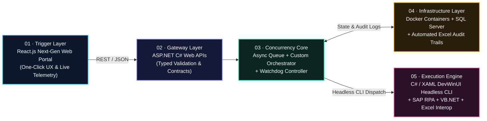

<div align="center">

<br />

[](https://curriculum-vitae-topaz-beta.vercel.app)
[](./public/Alan_Avina_CV.pdf)
[](https://www.linkedin.com/in/alan-avina)
[](mailto:alan.avinav@gmail.com)

<br />

# ALAN EMMANUEL AVIÑA VENEGAS

### **Software & Automation Engineer · Distributed Systems · Full-Stack & Design Engineering**

*`.NET / C#` · `ASP.NET Web APIs` · `React.js & Next.js` · `Docker & SQL` · `SAP RPA` · `Three.js / WebGL` · `AWS Cloud`*

<br />

🌐 **English** · [🇲🇽 Versión en Español](./README.es.md)

<br />

> **Most engineers specialize in either backend reliability or frontend craft.**  
> **I engineer the entire vertical**—from collision-free distributed orchestrators and headless `.NET` automation engines to real-time `React / WebGL` control planes—while aligning senior stakeholders so teams ship faster with **measurable business ROI**.

</div>

---

## ⚡ Engineering Impact — The Value I Bring to Your Team

| **230+ hrs/year Saved** | **0 Process Collisions** | **0 ms UI Overhead** | **Executive-Ready Leadership** |
| :--- | :--- | :--- | :--- |
| Engineered one-click **SAP RPA** solutions at **Aumovio**, reclaiming **19+ hrs/month** (**>1 full work-month/year**) with strict data integrity. | Architected an **Async Queue + Custom Orchestrator + Watchdog** over **Docker**, **SQL Server**, and **ASP.NET C# Web APIs**. | Built a dual-mode **C# / XAML (`DevWinUI`)** engine with **Headless CLI** execution driven remotely by a **React.js** web portal. | Primary engineering liaison across **Financial Controlling**, **IT**, and multi-institution alliances (**Gobierno de Jalisco, SITEUR, Mi Bici**). |

---

## 🎯 How I Multiply Value on Your Team From Day One

Whether your organization needs high-reliability enterprise systems, polished user-facing products, or an engineer who bridges technical execution with business stakeholders, here is what I deliver immediately:

| If Your Team Needs... | What I Bring to the Table | Proven Track Record |
| :--- | :--- | :--- |
| **Enterprise Backend, .NET & Process Automation** | Production `C# / .NET`, `ASP.NET Web APIs`, `SAP RPA`, `SQL Server`, `Docker`, concurrency locking, and fault-tolerant job queues that turn error-prone manual operations into auditable one-click pipelines. | **Aumovio:** Architected on-premise distributed automation infrastructure saving **230+ hrs/yr** with **0 COM/process collisions**. |
| **Full-Stack Product & Design Engineering** | End-to-end ownership across `React.js`, `Next.js`, `TypeScript`, `Laravel`, `Python`, `Java Servlets`, and `Three.js / GSAP`—pairing clean API contracts with responsive, high-craft UI/UX. | **This Live Web CV**, **Restaurant POS** (PayPal + live kitchen queues), and **MyPetHealth** (Scrum + custom SVG UX). |
| **Cloud Delivery, Telemetry & Cross-Functional Leadership** | `AWS Cloud Practitioner` & `Scrum (SFPC)` certified execution, daily Scrum velocity, behavioral analytics (`Google Analytics`), Gantt governance, and assertive communication with directors & non-technical teams. | **Rinconcito Alliance:** Engineering lead connecting **Gobierno de Jalisco**, **SITEUR**, **Mi Bici**, and cultural partners on high-availability cloud deployments. |

---

## 🏭 Flagship Production Case Study: Aumovio Distributed Automation Engine

**Role:** Software & Automation Engineering Intern — *Plant Financial Controlling & Enterprise Systems* (`Jul 2026 – Present` · Guadalajara, MX)

### The Engineering Challenge
Financial Controlling workflows depended on heavy manual **SAP** and massive **Excel dataset** operations—consuming critical analyst hours every month and risking process collisions when multiple server workloads ran concurrently.

### The Architecture I Designed & Deployed
I built an end-to-end **on-premise distributed automation ecosystem** connecting a sleek web control plane directly to a high-speed headless desktop execution engine:



### Key Technical & Business Outcomes
* **230+ Hours/Year Reclaimed (`19+ hrs/month`):** Transformed complex manual financial processes into deterministic one-click executions across massive datasets while enforcing strict data integrity.
* **Collision-Free Concurrency (`0 Collisions`):** Engineered a custom **Orchestrator**, asynchronous **process queue**, and **Watchdog controller** to sequence server workloads safely without overlapping SAP or Excel COM sessions and recover stalled jobs automatically.
* **Headless Desktop Performance (`0 ms UI Overhead`):** Built a dual-mode **C# / XAML (`DevWinUI`)** desktop runtime featuring **headless CLI execution**, bypassing GUI rendering overhead entirely when triggered remotely from the **React.js** portal.
* **Enterprise Governance:** Executed in daily **Scrum** sprints bridging Financial Controlling and IT teams via enterprise **GitHub CI**, aligned senior leadership and department heads, and governed full-lifecycle delivery through **Gantt roadmaps** and automated **Excel audit logs**.

---

## 🚀 Career Trajectory & Strategic Alliances

### **Aumovio** — *Software & Automation Engineering Intern*
`Jul 2026 – Present (Program: Jul 2026 – Jul 2027)` · `Guadalajara, MX` · *Plant Financial Controlling & Enterprise Systems*
* **Stack:** `C#` · `.NET` · `ASP.NET Web APIs` · `DevWinUI (XAML)` · `SAP RPA` · `VB.NET` · `Excel Interop` · `Docker` · `SQL Server` · `React.js` · `GitHub CI` · `Scrum`
* Delivered full-stack enterprise automation, containerized server orchestration, and cross-departmental executive alignment (detailed above).

### **Guía Cultural Metropolitana “Rinconcito”** — *Technology Infrastructure Engineer & Full Stack Developer*
`Feb 2026 – Jun 2026` · `Guadalajara, MX` · *State-Wide Strategic Cultural Ecosystem*
* **Stack:** `Full Stack Web` · `High-Availability Cloud` · `Google Analytics` · `Behavioral Telemetry` · `REST APIs`
* Led technical architecture and assertive stakeholder communication as **primary engineering liaison** in a high-visibility alliance backed by **Gobierno de Jalisco, SITEUR, Mi Bici, Casa Profunda, and Arte Convergente**.
* Engineered **user-preference pattern tracking** and behavioral telemetry pipelines integrated with **Google Analytics**, delivering real-time audience insights over high-availability cloud deployments.

---

## 🛠️ Selected Software Systems & Projects

| Project | Role | Architecture & Stack | Engineering Impact |
| :--- | :--- | :--- | :--- |
| **Restaurant POS & Real-Time Dashboard** | Full Stack Architect & UI Engineer | `Laravel` · `Tailwind CSS` · `REST APIs` · `PayPal API` · `Postman` | Architected a microservices-inspired workflow synchronizing waiter terminals, live kitchen queues, and encrypted **PayPal API** checkout, paired with a real-time **Glassmorphism/Neumorphism** BI dashboard verified across peak scenarios with **Postman**. |
| **MyPetHealth — Clinical Vet System** | Project Manager (Scrum) & Lead Dev | `Python Full Stack` · `Secure Auth` · `Relational DB` · `Neumorphism` · `SVG` · `Scrum` | Directed end-to-end SDLC delivery under **Scrum**, engineering encrypted authentication and clinical record backends paired with a tactile **Neumorphism** UI and custom choreographed **SVG** loading animations. |
| **ERP & Automated Queue “El Paraíso”** | Full Stack Systems Developer | `Java Servlets` · `MySQL` · `WhatsApp API` · `Production Queues` | Unified an administrative ERP and client ordering portal on normalized **MySQL** transactions, building **WhatsApp API** automation that injects payment-confirmed web orders directly into the live Kitchen Production Queue without human relay. |
| **Inventory & BI Suite “Abarrotes Romero”** | Software Developer | `Python` · `Tkinter` · `Matplotlib` · `ReportLab PDF` · `SQL` | Built a high-frequency retail CRUD desktop suite integrating **Matplotlib** analytics with **ReportLab** to generate one-click executive PDF reports for data-driven purchasing. |

<details>
<summary><strong>🔬 Expand Computer Science & Systems Lab Vault (4 Additional Projects)</strong></summary>

<br />

* **Clínica CONSUYAD (`C# · .NET Desktop · SQL`):** Desktop clinical dossier digitization platform built for paperless medical record governance.
* **Formal Automata & Turing Machine Simulator (`Python · Theory of Computation`):** Deterministic state-transition simulator processing formal grammars and tape operations visually.
* **Minimax Game AI & EcoBot (`C++ · Arduino · Adversarial Search`):** Decision-tree game theory solver integrated with embedded robotics prototyping.
* **Native Android Suite (`Java · Android Studio`):** Mobile biometric health-tracking and precision utility apps built with native Android SDKs.

</details>

---

## 🧰 Full-Spectrum Technical Arsenal

| Domain | Technologies & Capabilities |
| :--- | :--- |
| **Languages** | `C#` · `Python` · `JavaScript (ES6+)` · `TypeScript` · `SQL` · `PHP` · `Java` · `Visual Basic (VB.NET)` · `HTML5` · `CSS3` · `XAML` |
| **Backend, Desktop & RPA** | `.NET` · `ASP.NET Web APIs` · `DevWinUI` · `SAP RPA` · `Async Process Queues & Orchestration` · `Watchdog Concurrency` · `Excel Interop` · `Laravel` · `Java Servlets` · `REST APIs` |
| **Frontend, WebGL & UI/UX** | `React.js` · `Next.js` · `Three.js / React Three Fiber` · `GSAP ScrollTrigger` · `Lenis` · `Tailwind CSS` · `GLSL Shaders` · `Liquid Glass / Glassmorphism / Neumorphism` · `Custom SVG` · `Google Analytics` |
| **Cloud, Containers & Data** | `Docker` · `SQL Server` · `MySQL` · `MongoDB` · `AWS (EC2, S3)` · `On-Premise Servers` · `Vercel` · `Git / GitHub CI` · `Postman` |
| **Governance & Leadership** | `Scrum (SFPC)` · `Gantt Roadmaps` · `Automated Audit Trails` · `Cross-Functional Technical Leadership` · `Assertive Stakeholder & Executive Alignment` · `Customer Obsession` |

---

## 🎓 Education, Certifications & Languages

* **B.S. in Computer Science** *(Ingeniería en Ciencias Computacionales)* — **University of Guadalajara (CUTonalá)** · `2023 – 2027 (Expected)`
  * *Core Coursework:* Data Structures & Algorithms, Software Engineering, Cloud Computing, Database Systems, Theory of Computation.
* **Verified Certifications:**
  * ☁️ **AWS Cloud Practitioner** — *Amazon Web Services*
  * 🔄 **Scrum Fundamentals Certified (SFPC)** — *CertiProf / Agile*
* **Languages:** **Spanish** *(Native)* · **English** *(B2 Upper-Intermediate)*

---

## 💎 About This Repository (`Web_CV`) — Proof of Engineering Craft

This repository powers my live interactive portfolio (**[curriculum-vitae-topaz-beta.vercel.app](https://curriculum-vitae-topaz-beta.vercel.app)**)—engineered from scratch with **React 19, TypeScript, Vite 6, Tailwind CSS v4, Three.js, GLSL, and GSAP** as a live demonstration of **Design Engineering & Performance Optimization**:

* **Procedural WebGL Stage (`SceneCanvas`, `ReactiveShaderBackdrop`, `MorphingLiquidCore`):** Custom **GLSL fragment shader** generating real-time caustic light ribbons driven by pointer velocity and scroll depth, paired with a scroll-choreographed refractive `MeshTransmissionMaterial` core and zero-CDN studio `Lightformer` HDRI lighting with adaptive `PerformanceMonitor` DPR scaling.
* **Optical Liquid Glass Engine (`LiquidGlassFilter`, `LiquidGlassCard`):** SVG `<feTurbulence>` + `<feDisplacementMap>` DOM refraction filter bank combined with proximity-aware (`110px`) 3D perspective tilt and Newton-spectrum prismatic rim dispersion.
* **Interactive 3D `.glb` Optical Inspector (`GLBOpticalSandbox`):** Drag-and-drop binary `.glb` model viewer (defaults to `public/models/aumovio-prism.glb`) with live physical Index-of-Refraction presets (`IOR 1.52`, `1.64`, `2.42`), chromatic dispersion, and distortion controls.
* **Zero-Re-Render Motion Pipeline (`Lenis` + `GSAP` + `motionState`):** Synchronized `60fps` scroll choreography communicating through mutable frame-rate references instead of React state updates.
* **Bilingual Architecture (`EN / ES`) + Bundled ATS PDF:** Full English/Spanish dictionary in `src/data/portfolioData.ts` plus one-click download of `public/Alan_Avina_CV.pdf`.

<details>
<summary><strong>📂 Repository Structure & Local Development Commands</strong></summary>

```text
Web_CV/
├── public/
│   ├── Alan_Avina_CV.pdf          # 1-page Harvard Minimalist ATS Resume (PDF)
│   ├── favicon.svg
│   └── models/aumovio-prism.glb   # Default 3D refractive artifact
├── src/
│   ├── components/
│   │   ├── canvas/                # Three.js / R3F WebGL stage & GLSL caustic backdrop
│   │   ├── sections/              # Hero, Aumovio Spotlight, Timeline, 3D Carousel, GLB Lab, Bento, Contact
│   │   └── ui/                    # SVG refraction filters, LiquidGlassCard, MagneticButton, CustomCursor
│   ├── data/portfolioData.ts      # Complete EN/ES engineering & trajectory dataset
│   ├── store/motionState.ts       # Mutable 60fps scroll & pointer telemetry bridge
│   └── App.tsx
├── package.json
└── vercel.json
```

```bash
# Install dependencies
npm install

# Start local Vite development server
npm run dev

# Type-check (tsc -b) and build production bundle
npm run build

# Preview production bundle locally
npm run preview
```

</details>

---

<div align="center">

## 🤝 Let’s Build Something High-Impact

**Available for Software Engineering, Distributed Automation (.NET / C#), Full-Stack & Design Engineering roles**  
*Guadalajara, MX · Remote · International*

<br />

[](mailto:alan.avinav@gmail.com)
[](https://www.linkedin.com/in/alan-avina)
[](https://curriculum-vitae-topaz-beta.vercel.app)
[](./public/Alan_Avina_CV.pdf)

<br />

📍 Tonalá / Guadalajara, Jalisco, México

</div>
